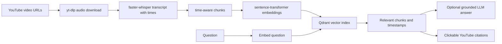

# Timestamped Lecture RAG

Retrieval over a YouTube DSA playlist. A student asks a question in Hinglish or English and
gets an answer **plus clickable links that jump to the relevant moment in a lecture**.

```
"bhai memoization aur tabulation ka difference kahan explain kiya hai?"

→ Answer: 3-4 lines, grounded only in what was actually said
→ Sources:
   [1] DP Lecture 3 — Memoization Deep Dive        @ 12:04   ▸ jump
   [2] DP Lecture 5 — Tabulation Recipe            @ 04:31   ▸ jump
```

The repository includes a sample corpus of 126 transcripts and a prebuilt vector export. Those
are sample course data, separate from your own custom index. Use the workflow below to build
an index for your own lessons.

---

## Stack

| Layer | Choice |
|---|---|
| Playlist + audio | `yt-dlp` (Python API) |
| Transcription | `faster-whisper` (CTranslate2), `large-v3`, batched |
| Chunking | hand-written, time-window based |
| Embeddings | `sentence-transformers` + `all-MiniLM-L6-v2` by default (`BAAI/bge-m3` is optional) |
| Vector store | Qdrant local by default; hosted Qdrant is configurable |
| LLM | Gemini or Groq, selected from configured API keys; retrieval works without an LLM |
| CLI | `typer` + `rich` |
| API + UI | `FastAPI` + a single HTML page with the YouTube IFrame API |

---

## Setup

```bash
cd <repository-directory>
uv venv --python 3.11
uv --cache-dir .uv-cache sync
```

The CUDA runtime libs that `ctranslate2` needs on Windows are an optional extra:

```bash
uv --cache-dir .uv-cache sync --extra cuda
```

If your GPU is newer than the shipped `ctranslate2` build, `transcribe.py` catches the
failure and falls back to CPU `int8` with a printed warning. Slower, still correct.

**Embeddings run on CPU by default.** `uv` pulls the CPU build of torch from PyPI, so bge-m3
embeds on the CPU — fine for querying, and a few minutes rather than seconds when reindexing
a full playlist. To put it on the GPU (~3GB download):

```bash
uv pip install torch --index-url https://download.pytorch.org/whl/cu124 --force-reinstall
```

Transcription is unaffected either way: `ctranslate2` ships its own CUDA support and already
uses the GPU.

From this project folder, copy `.env.example` to `.env` and optionally add an LLM key. Search
works without an LLM; the key enables grounded answer generation.

```
GROQ_API_KEY=...
# Optional hosted Qdrant settings; leave blank for local Qdrant
QDRANT_URL=
QDRANT_API_KEY=
```

---

## How it works



The CLI handles ingestion and index management. FastAPI serves search, optional answer
generation, metadata, and the browser UI. Transcripts are cached so interrupted ingestion can
resume.

## Runtime data

By default, runtime data lives in `~/.ytrag/`; `YTRAG_ROOT` and `YTRAG_QDRANT_PATH`
can point it elsewhere:

```
~/.ytrag/
├── audio/        # <video_id>.m4a — DELETABLE, regenerable in seconds
├── transcripts/  # <video_id>.json — PRECIOUS, hours of GPU time
└── langtest/     # output of `ytrag langtest`
```

That split is the whole point. Transcripts are the expensive artifact; everything downstream
of them is cheap to rebuild, which is why changing your mind about the embedding model or
the chunk size later costs minutes instead of hours.

---

## Usage

### 0a. Preflight

```bash
uv --cache-dir .uv-cache run python -m ytrag.cli preflight --playlist "<PLAYLIST_URL>"
```

Checks keys, Qdrant, the embedder, the Whisper model, the transcription code
path, playlist listing and the LLM — about a minute. Each check *calls* the
thing rather than asserting it looks importable, because this exists after an
8-hour run died ten seconds in on a missing import. Run it before any long
ingest.

### 0b. Decide the language flag first

```bash
uv --cache-dir .uv-cache run python -m ytrag.cli langtest "https://www.youtube.com/watch?v=<one_lecture>"
```

The lectures are Hinglish. `language="hi"` gives Devanagari output; `language="en"` gives
romanised/translated output. Student queries will be romanised Hinglish or English, so these
two produce *very* different retrieval behaviour.

Read a few minutes of each and check what happens to the technical terms specifically —
memoization, adjacency list, time complexity, subproblem, DP table. Whichever keeps those
clean, wins. Then set `YTRAG_WHISPER_LANG` and move on. This decision gets baked into hours
of compute afterwards, so make it on evidence.

### 1. Ingest

```bash
uv --cache-dir .uv-cache run python -m ytrag.cli ingest --playlist "<PLAYLIST_URL>" --limit 1     # Phase 0: one video, end to end
uv --cache-dir .uv-cache run python -m ytrag.cli ingest --playlist "<PLAYLIST_URL>"               # Phase 1: the whole thing
```

Per video: download audio → transcribe (cached) → delete audio → chunk → upsert. One failing
video logs and the run continues. Re-running re-transcribes nothing and duplicates nothing.

#### Speed, measured on an RTX 5050 laptop

Transcription is the only expensive step, and it is paid exactly once — chunking,
embedding and indexing take seconds, and everything downstream rebuilds from cached
transcripts.

| config | speed | 68.7-hour playlist |
|---|---|---|
| `large-v3` sequential, beam 5 (as RAGPLAN specified) | 2.5x realtime | ~27 h |
| `large-v3` **batch 8**, beam 5 — the default here | **8.1x** | **~8.5 h** |
| `large-v3` batch 8, beam 1 | 10.5x | ~6.5 h |

Batching is not a quality tradeoff: same model, same weights, identical technical-term
capture in testing. The sequential path simply leaves the GPU idle between speech
regions. Beam 1 is a real further gain but uses greedy decoding, which is likeliest to
slip on exactly the thing that matters here — an unusual technical term in accented
speech — so the default stays at beam 5.

#### Surviving a long unattended run

Everything is built to be re-run. The command never changes:

```bash
uv --cache-dir .uv-cache run python -m ytrag.cli ingest --playlist "<PLAYLIST_URL>"
```

- **Power cut.** Transcripts are written to a temp file and atomically renamed, so you
  get a complete file or none — never a truncated one the cache then trusts forever.
  Re-run and every finished video is skipped; you lose only the one in flight.
- **Network drop.** Downloads and Qdrant upserts retry four times with exponential
  backoff, so a brief blip costs seconds. Both operations are idempotent, so a retry
  after a partial success is harmless.
- **Network death.** After `--stop-after-failures` videos fail back to back (default 5)
  the run aborts with a clear message instead of ripping through the rest of the
  playlist failing instantly and reporting a "finished" run that did nothing.
- **Ctrl-C.** Caught explicitly; cached work is safe.
- Whisper and the embedding model are cached on disk after first use, so transcription
  itself needs no network at all.

Don't let the machine sleep mid-run — power loss is survivable, suspending the GPU
mid-inference is messier.

### 2. Ask

```bash
uv --cache-dir .uv-cache run python -m ytrag.cli ask "memoization aur tabulation ka difference kya hai?"
uv --cache-dir .uv-cache run python -m ytrag.cli search "adjacency list"      # retrieval only, shows raw distances
```

### 3. Evaluate

```bash
uv --cache-dir .uv-cache run python -m ytrag.cli eval --verbose
```

### 4. Web UI

```bash
uv --cache-dir .uv-cache run python -m ytrag.cli serve
```

Then <http://127.0.0.1:8000>. Citations call `player.seekTo()` on the embedded player, so
clicking `[2]` jumps *inside the page* rather than opening a tab.

### Other commands

```bash
uv --cache-dir .uv-cache run python -m ytrag.cli preflight            # check every dependency before a long run
uv --cache-dir .uv-cache run python -m ytrag.cli reindex              # re-chunk + re-embed from cached transcripts
uv --cache-dir .uv-cache run python -m ytrag.cli reindex --replace    # same, but clear old chunks first (needed if chunk size changed)
uv --cache-dir .uv-cache run python -m ytrag.cli stats
uv --cache-dir .uv-cache run python -m ytrag.cli clean-audio
```

---

## Sharing this with students

Students should **never transcribe**. That step needs a decent GPU and ~8.5 hours; on a
typical laptop CPU it would be days. But its output is just text — about **1.4 KB per minute
of video**, so this entire 68.7-hour playlist ships as ~6 MB of JSON (1.5 MB zipped).

So the expensive artifact gets committed to the repo, and everyone else skips straight past
the expensive half.

```bash
uv --cache-dir .uv-cache run python -m ytrag.cli export-transcripts     # copy ~/.ytrag/transcripts -> ./transcripts
git add transcripts && git commit
```

Three ways someone can then use it:

**1. Just use it — zero install.** Point them at the deployed URL. No Python, no keys, no
downloads. This is the right answer for almost everyone.

**2. Run it locally.** Clone, copy `.env.example` to `.env`, and optionally add a Gemini or
Groq key. Qdrant runs locally unless `QDRANT_URL` is configured. Then:

```bash
uv --cache-dir .uv-cache sync
YTRAG_EMBED_MODEL=all-MiniLM-L6-v2 uv --cache-dir .uv-cache run python -m ytrag.cli reindex
uv --cache-dir .uv-cache run python -m ytrag.cli ask "memoization kya hota hai?"
```

`reindex` finds the bundled `transcripts/` automatically. It uses `all-MiniLM-L6-v2` by
default; `BAAI/bge-m3` is an optional multilingual model that can be selected in config.

**3. Point it at their own playlist.** The full pipeline, on whatever content they have.
That's the version that needs a GPU — and their own playlist is probably a lot shorter than
68 hours.

The split that makes this work is the same one that makes re-tuning cheap locally:
transcripts are precious and portable, everything downstream is disposable.

## Configuration

Everything is env-driven; defaults live in [ytrag/config.py](ytrag/config.py).

| Variable | Default | Notes |
|---|---|---|
| `YTRAG_WHISPER_LANG` | `en` | Decide this with `langtest` first |
| `YTRAG_WHISPER_MODEL` | `large-v3` | `medium` if you're impatient |
| `YTRAG_WHISPER_DEVICE` | `auto` | `cuda` / `cpu` to force |
| `YTRAG_WHISPER_BATCH` | `8` | Batched inference — see below. `0` disables |
| `YTRAG_WHISPER_BEAM` | `5` | `1` is ~30% faster, greedy decoding |
| `YTRAG_CHUNK_SECONDS` | `75` | ~one explained idea |
| `YTRAG_CHUNK_OVERLAP` | `15` | |
| `YTRAG_EMBED_MODEL` | `all-MiniLM-L6-v2` | `BAAI/bge-m3` for stronger multilingual retrieval |
| `YTRAG_COLLECTION` | `dsa_lectures` | the embedding dim gets appended |
| `YTRAG_TOP_K` | `6` | |
| `YTRAG_MAX_DISTANCE` | `0.6` | the grounding cutoff — see below, and re-tune |
| `YTRAG_WHISPER_WINDOW_SECONDS` | `600` | Max audio window for long recordings |
| `YTRAG_LLM_MODEL` | `openai/gpt-oss-120b` | |

---

## The golden set

[eval/golden.json](eval/golden.json) holds two kinds of entry.

**Retrieval** — a hit means the expected video appears in top-k *and* at least one returned
chunk overlaps `expect_around_sec ± tolerance_sec`:

```json
{"q": "memoization vs tabulation kya difference hai?",
 "expect_video_id": "abc123", "expect_around_sec": 724, "tolerance_sec": 120}
```

**Refusal** — a hit means the pipeline declines to answer:

```json
{"q": "React hooks kaise kaam karte hain?", "expect_refusal": true}
```

The shipped golden set has 30 positive retrieval questions with expected video IDs and
approximate timestamps, plus five out-of-course refusal questions. The draft annotations
include the intended video title and timestamp for review in
[`eval/golden_draft.json`](eval/golden_draft.json). This is a small, hand-curated set, not a
statistically representative benchmark. Review the annotations and add examples from your own
course before making claims about retrieval quality.

Run the evaluator against the bundled sample index:

```bash
uv --cache-dir .uv-cache run --locked python -m ytrag.cli eval
```

For a shareable report, save the full per-question output as well:

```bash
uv --cache-dir .uv-cache run --locked python -m ytrag.cli eval --json-out eval-results/baseline.json
```

It reports video-level and timestamp-window hit rates, MRR@k, mean rank, mean timestamp error,
refusal performance, and individual misses. The repository has no claimed score: run it against
the exact index and model you plan to demonstrate, then record that output. `eval-results/` is
ignored by Git so local experiment reports do not get published accidentally.

### Tuning `MAX_DISTANCE`

The current default is `0.6`. Similarity distances depend on the embedding model and your
transcript corpus, so treat this as a starting point. Add in-syllabus questions and off-topic
refusal examples to your golden set, then use `ytrag search` and `ytrag eval` to tune the
cutoff against your own playlist. Historical measurements from another embedding model or
corpus should not be reused as if they were universal.

---

## The failure modes this codebase is built around

**Don't use a generic text splitter.** `RecursiveCharacterTextSplitter` operates on one
concatenated string and throws the timestamps away. The timestamp *is* the product here, so
[ytrag/chunk.py](ytrag/chunk.py) chunks on the segment list, in the time domain, and never
splits a segment.

**Whisper loop hallucinations.** On silence or a music sting Whisper repeats the previous
phrase forever. `condition_on_previous_text=False` and `vad_filter=True` cut most of it;
`is_repetitive()` in `chunk.py` drops what survives. These chunks are retrieval poison — they
match everything and say nothing.

**The transcript cache is the most important line in the codebase.** Re-transcribing a
40-video playlist by accident costs hours. It's written atomically (temp file + `os.replace`)
so a Ctrl-C mid-write can't leave a truncated file that the cache check then trusts forever.

**The timestamp should land slightly early.** Retrieval hits the chunk containing the answer,
but the explanation usually starts just before it. Citation URLs rewind 5 seconds
(`YTRAG_LINK_REWIND`). Small thing, noticeably better feel.

**Ungrounded answers will destroy the demo.** The model knows DSA perfectly well. Given junk
context it will answer from its own training and cheerfully attach your timestamps to it —
the student clicks and you're talking about something else. That is strictly worse than
saying "cover nahi hua". Three guards in [ytrag/answer.py](ytrag/answer.py):

1. drop everything above `MAX_DISTANCE`, and if nothing survives return the refusal
   **without calling the LLM at all**;
2. honour the model's own refusal;
3. an answer with zero citations is marked `grounded: false` and gets no links.

**Idempotency.** Cached transcripts, `upsert` not `add`, deterministic point IDs
(`uuid5` of `"{video_id}:{start_sec}"`), resume on partial failure. You *will* re-run this
many times.

---

## Deploying to Render

The repository includes a `render.yaml` blueprint for the query web service. Push this
folder as the GitHub repository root, then create a Render Blueprint from that repository.
The blueprint uses the `my_course_v2` Qdrant collection and `all-MiniLM-L6-v2` embedding
model. Keep those values the same in your local setup. Add `QDRANT_URL` and `QDRANT_API_KEY`
to Render as secrets. Add `GROQ_API_KEY` or `GEMINI_API_KEY` only if you want generated
answers; timestamp search works without an LLM key. Never commit `.env`, transcript files,
course vector exports, or API keys.

Render's free filesystem is ephemeral, so the deployed app must use hosted Qdrant rather
than the local Qdrant folder. The blueprint runs search and Q&A only; ingest your videos
locally with a GPU, then export and upload the vectors:

```powershell
$env:YTRAG_COLLECTION = "my_course_v2"
uv --cache-dir .uv-cache run --locked python -m ytrag.cli export-vectors --out course-vectors.npz
$env:QDRANT_URL = "<YOUR_QDRANT_URL>"
$env:QDRANT_API_KEY = "<YOUR_QDRANT_API_KEY>"
uv --cache-dir .uv-cache run --locked python -m ytrag.cli load --path course-vectors.npz
Remove-Item Env:QDRANT_URL
Remove-Item Env:QDRANT_API_KEY
Remove-Item Env:YTRAG_COLLECTION
```

The export contains transcript text and embeddings. Keep it out of GitHub unless you have
permission to redistribute the source material; the repository's `.gitignore` excludes
local transcript and vector data by default.

Use the same `YTRAG_COLLECTION` and `YTRAG_EMBED_MODEL` locally and on Render. The free
Render web plan has 512 MB RAM and may be too small for the embedding model; if startup runs
out of memory, choose a larger plan. Free services also spin down when idle and their
filesystem changes do not persist. See [Render's free plan limits](https://render.com/docs/free).

`/ask` and `/search` are rate-limited per IP and question length is capped. `/health` checks
process liveness; `/ready` checks that the configured Qdrant collection has searchable chunks.
The limiter is in-process, so move it to shared storage before running multiple web instances.

---

## Portfolio checklist

- [x] Sample transcript corpus, vector export, resumable CLI ingestion, and web search UI
- [x] Positive and out-of-course examples in the retrieval evaluation set
- [x] Render blueprint and hosted-Qdrant deployment instructions
- [x] Core unit tests and a GitHub Actions CI workflow
- [ ] Capture passing CI and evaluation results for the demo version
- [ ] Deploy the app and add public links after checking source-data rights

## Resume wording

Use only measurements you have run and can explain. For example:

> Built a timestamp-aware RAG application for YouTube lectures using FastAPI, faster-whisper,
> sentence-transformers, and Qdrant; indexed **[N] lessons / [H] hours** and measured
> **[X]% top-5 video hit rate** and **[Y]% timestamp-window hit rate** on **[Q] questions**,
> with citations linking directly to lecture moments.

The sample contains 126 transcript files. Indexed lesson count, hours, and evaluation scores
depend on the vector collection actually used, so take those figures from app/evaluator output
rather than assuming the bundled transcript count is indexed.
